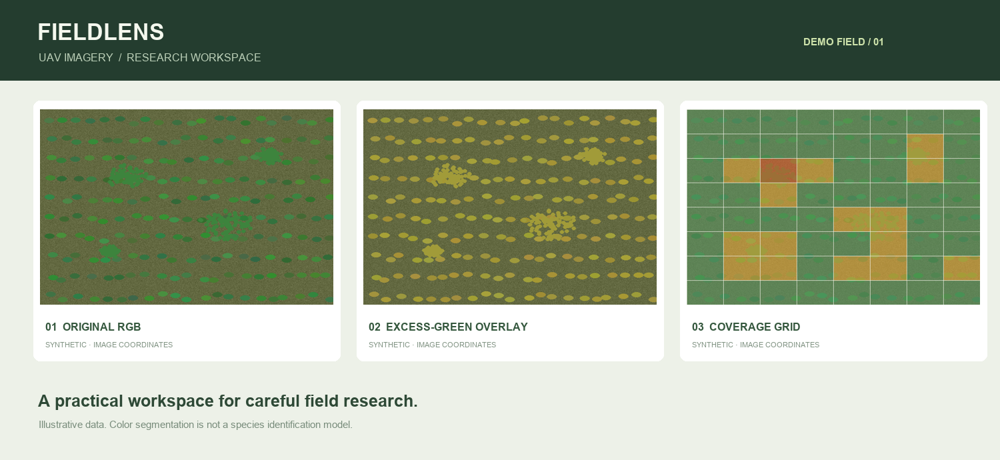
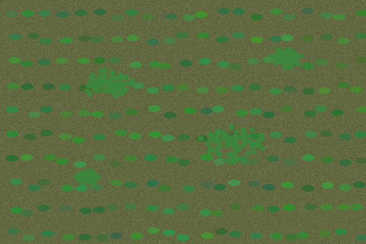
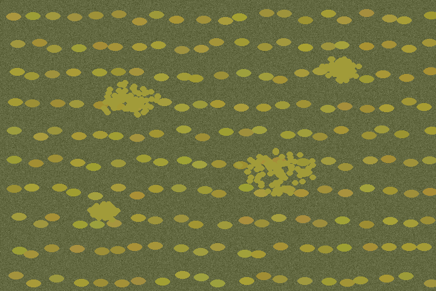
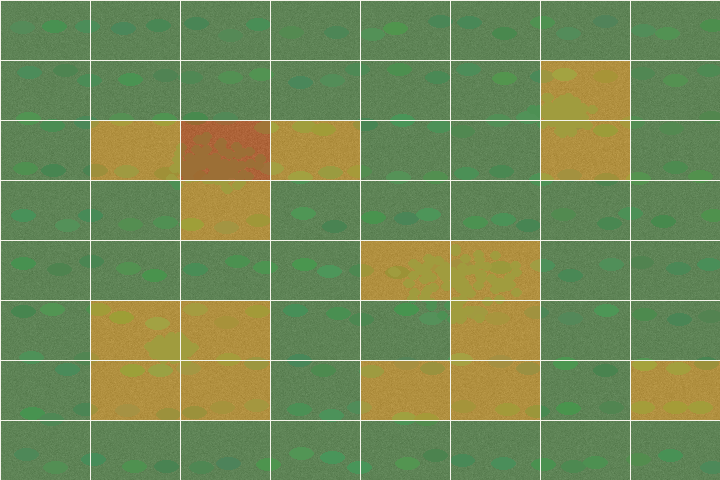

# 🌾 Fieldlens

### A field research studio for UAV imagery

Explore an aerial image, compare segmentation masks, and review the evidence behind a result—all from a local browser workspace.



> **Research prototype:** The sample images above are synthetic. The supplied paper reports illustrative simulations, not measured model results. Fieldlens does not include a validated weedy-rice model.

---

## Start here

**1. Install Python 3.10 or newer** and extract this folder. Open a terminal in the folder and install the dependencies:

```bash
python -m pip install -r requirements.txt
```

**2. Start the app:**

```bash
python server.py
```

The browser opens at **http://127.0.0.1:8765**. Keep the terminal open while you use the app; press `Ctrl+C` to stop the server. On Windows, you can also double-click **Start Fieldlens.bat** after installing the dependencies.

**3. Choose “Start guided demo.”** Follow the three steps to load the synthetic field, run an analysis, and explore its coverage grid.

---

## A look inside

### 01 · Start with an image

Upload an RGB UAV image or explore the built-in synthetic field. If you have a ground-truth mask, upload it as a reference: **white is foreground, black is background**.



### 02 · Choose how to analyze it

| Method | What it does | What you need |
| --- | --- | --- |
| **Excess-green heuristic** | Highlights pixels based on `2G − R − B` and your selected threshold. | An RGB image. |
| **Evaluate uploaded prediction** | Evaluates a binary mask produced by your own segmentation model. | An image and matching prediction mask; add a reference mask for overlap metrics. |
| **User-trained pixel classifier** | Trains a scikit-learn random forest on pixel-color features from your labels. | A labeled image and matching reference mask with both foreground and background. |



*Amber shows predicted foreground in the overlay. Excess green is a color heuristic; cultivated rice and weeds can both be green.*

### 03 · Inspect and export

Switch between **Original**, **Overlay**, **Prediction**, **Errors**, and **Coverage grid**. When a reference mask is present, the app calculates pixel-level **IoU, Dice, precision, and recall**. In the error view, green indicates true positives, amber false positives, and red false negatives.



*The grid summarizes the proportion of predicted pixels in each cell. Green is below 20%, amber is 20–50%, and red is at least 50%. It is an image-coordinate grid, not a georeferenced field map.*

Export a binary **PNG mask**, a **JSON report**, or a per-cell **CSV grid** using the buttons below the results.

---

## Train your own pixel classifier

1. Load an RGB image and its matching binary reference mask.
2. Expand **Train a pixel classifier** and select **Train from current pair**.
3. Load a separate field image, select **User-trained pixel classifier**, and run analysis. Add a matching reference mask for evaluation.
4. Review errors and evaluate across independent fields before relying on the classifier.

The classifier is stored in server memory and disappears when the server stops. Performance on the training image does **not** establish performance on a new field. The classifier is a pixel-color baseline, not U-Net, DeepLabV3+, or SegFormer.

## What the paper contributes

The supplied paper proposes a way to compare those three deep-learning architectures with consistent settings and field-disjoint groups. It emphasizes grouping overlapping physical footprints before splitting, evaluating segmentation separately from mapping geometry, and tracing predictions back to their sources. The numerical tables in the paper are explicitly **simulated**, and no trained models are supplied.

## Boundaries and input details

- Images are processed locally in memory. The server listens on `127.0.0.1`.
- Images are limited to **20 MB and 16 megapixels**. Pillow-supported PNG, JPEG, and TIFF inputs can be used.
- Masks must have the same dimensions as the image; grayscale values of **128 or greater** are treated as foreground.
- All image pixels are treated as valid. There is no nodata mask, spatial registration, CRS handling, or physical area calculation.
- Pixel coverage is not a plant count, yield estimate, or treatment prescription. Validate your labels, predictions, and field geometry independently.
- Empty metric denominators are shown as a dash. The demo uses synthetic data and is not an estimate of real-world performance.

## Built with

[Python](https://www.python.org/) · [Pillow](https://python-pillow.org/) · [NumPy](https://numpy.org/) · [scikit-learn](https://scikit-learn.org/) · HTML, CSS, and JavaScript

## Further reading

- [Agristry field mapping](https://agristry.com/about/field-mapping/)
- [QGIS workflow for UAS imagery plant classification](https://acsess.onlinelibrary.wiley.com/doi/10.1002/ppj2.70030)
- [scikit-learn random forest classifier](https://scikit-learn.org/stable/modules/generated/sklearn.ensemble.RandomForestClassifier.html)

---

<sub>FIELDLENS · BUILT FOR CAREFUL FIELD RESEARCH</sub>
